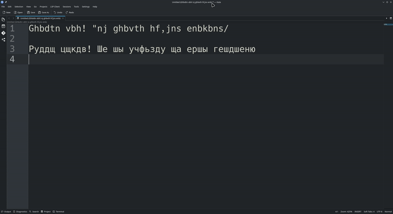

# layout-fix

Hotkey utility for KDE Wayland that fixes text typed in the wrong keyboard
layout — no background daemon, no keylogging. Select the garbled text,
press a hotkey, paste the corrected version (or let the tool paste it for you).

Works with whatever layouts you have configured in KDE (EN ↔ RU, EN ↔ UA, …):
the character mapping is read from XKB at runtime, not hard-coded.

## Example



## How it works

1. You select some text (mouse or Shift+arrows) — no need to copy it.
2. You press a hotkey.
3. The tool reads the selection and, word by word, finds out which of your
   layouts it was typed in, then converts it to the same physical keys in
   the other layout.
4. The result goes into the clipboard, and a native KDE OSD (the same
   widget used for layout-switch/volume popups) briefly shows a preview.
5. You paste it with Ctrl+V, replacing the still-selected text — or, with
   `--paste`, the tool does it and then puts your old clipboard back.

The binary is not resident — it runs once per hotkey press and exits.
Nothing is monitored in the background.

The converted text is marked as sensitive (`x-kde-passwordManagerHint`),
so Klipper and other clipboard managers that respect the hint don't add it
to their history.

## Requirements

- KDE Plasma on Wayland (uses the Plasma OSD and the KDE keyboard layout
  service over D-Bus)
- [`wl-clipboard`](https://github.com/bugaevc/wl-clipboard) (`wl-paste` /
  `wl-copy`), for example: `sudo pacman -S wl-clipboard`. Version 2.3 or
  newer is needed to keep the converted text out of clipboard history;
  older versions still work, just without that.
- `libxkbcommon` and `xkeyboard-config` (already installed with Plasma)
- For `--paste`: `xdg-desktop-portal` and `xdg-desktop-portal-kde`
  (installed with Plasma). Nothing else: pasting goes through the standard
  RemoteDesktop portal, no extra service or `/dev/uinput` access needed.

## Install

Build from source:

```bash
git clone https://github.com/AkuLinker/layout-fix.git
cd layout-fix
cargo build --release
```

Then:

```bash
mkdir -p ~/.local/bin ~/.local/share/applications
cp target/release/layout-fix ~/.local/bin/
cp io.github.akulinker.LayoutFix.desktop ~/.local/share/applications/
```

The `.desktop` file is hidden from menus. It gives the tool a fixed
application ID, which the portal uses to remember the `--paste` permission
(see below).

Or grab a prebuilt binary from [Releases](../../releases).

## Set up the hotkey

System Settings → Keyboard → Shortcuts → Add New → Command or Script.

- **Command/URL:** `/home/<you>/.local/bin/layout-fix` plus any options
  below, e.g. `/home/<you>/.local/bin/layout-fix --paste --switch-layout`
- **Trigger:** any unused combination, e.g. `Meta+;`

You can add several shortcuts with different options.

## Options

| Option | What it does |
| --- | --- |
| *(none)* | Convert and put the result in the clipboard; you press Ctrl+V |
| `--paste` | Paste automatically, then restore what was in the clipboard before |
| `--paste-delay <MS>` | Wait this long before pasting (default 150), so you have time to release the hotkey's modifier keys |
| `--switch-layout` | Switch the active keyboard layout to the one the text was converted into |

If nothing gets pasted, or some other shortcut fires instead, your hotkey's
modifier keys were probably still held down: increase `--paste-delay`.

After changing a shortcut's command, log out and back in if KDE keeps
running the old one.

### The permission dialog for `--paste`

`--paste` presses Ctrl+V through the RemoteDesktop portal, so the first
time KDE asks whether layout-fix may control the keyboard. Allow it and
leave the option to remember the choice checked. The portal then hands out
a restore token, saved in `~/.local/state/layout-fix/remote-desktop-token`
(readable only by you), and later presses run without a dialog. Tokens are
single-use; the tool saves the fresh one after every press.

The dialog shows up again if you uncheck "remember", if the token file is
deleted, or if the portal rejects the token. To make layout-fix forget the
permission, delete that file. If you deny the request, the converted text
stays in the clipboard and you can paste it with Ctrl+V.

## Character mapping

Each layout you've configured (read from `~/.config/kxkbrc`, including
variants) is compiled with libxkbcommon, and the tool records which
character each key of the main typing block produces, with and without
Shift. A character is converted by finding its key in the source layout
and taking what that key gives in the target layout. Characters that are
the same in both layouts (digits, `% * ( ) - _ = +`, …) stay the same, and
anything the source layout can't type — other scripts, emoji, diacritics —
passes through unchanged.

Direction is decided per word: each word is converted from the layout that
can type most of its letters. Words without letters (numbers, lone
punctuation) follow the nearest word that has letters. With more than two
layouts, the target is the currently active layout if it differs from the
source (you've already switched to the one you meant), otherwise the next
layout in your list. If the selection has no letters at all, the tool shows
a notice instead of guessing.

## Known limitations

- KDE's Klipper keeps the last PRIMARY selection indefinitely. If nothing
  is currently selected but something was selected earlier in the
  session, the tool will act on that old value instead of doing nothing.
- With `--paste`, only one format of the previous clipboard is restored:
  plain text for text, or the original type (e.g. `image/png`) for other
  data. Rich formats like HTML are dropped.
